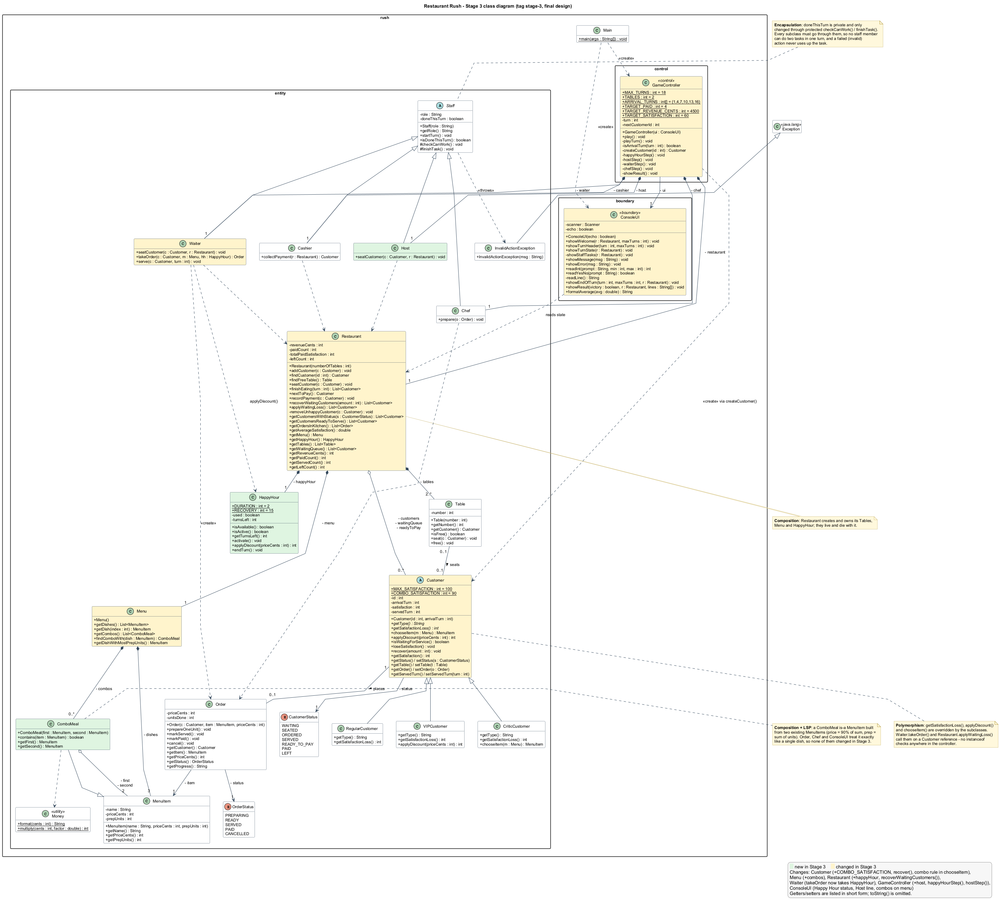

# 🍽️ Restaurant Rush

**SC2002 Group Project** · a turn-based, command-line restaurant management game in Java, built in three tagged stages.

[](https://github.com/manus369/SC2002-Lab-Assignment/tree/stage-1)
[](https://github.com/manus369/SC2002-Lab-Assignment/tree/stage-2)
[](https://github.com/manus369/SC2002-Lab-Assignment/tree/stage-3)


You are the manager of a small restaurant with **2 tables** and very little staff time: one Waiter, one Chef, one Cashier and, from Stage 3, one Host. Six customers arrive over **18 turns**. Every turn you decide who is seated, whose order is taken, which dish the kitchen works on and what gets served. Waiting customers lose satisfaction and walk out without paying when it reaches 0.

**Win** after turn 18 with **≥ 4 paid customers**, **≥ $45.00 revenue** and an **average satisfaction of paid customers ≥ 60**. Anything less is a defeat.

**Repository:** https://github.com/manus369/SC2002-Lab-Assignment

---

## Contents

1. [Quick start](#1-quick-start)
2. [Stages and tags](#2-stages-and-tags)
3. [Design at a glance](#3-design-at-a-glance)
4. [Stage comparisons and change maps](#4-stage-comparisons-and-change-maps)
5. [Documented game rules](#5-documented-game-rules)
6. [Test notes: reproducible runs](#6-test-notes-reproducible-runs)
7. [UML diagrams](#7-uml-diagrams)
8. [Presentation video](#8-presentation-video)
9. [Team and AI history](#9-team-and-ai-history)
10. [Project structure](#10-project-structure)

---

## 1. Quick start

Requires **JDK 17 or newer** (tested with OpenJDK 21). No network access or external libraries are needed.

**Git Bash / macOS / Linux**

```bash
javac -d out $(find src -name "*.java")
java -cp out rush.Main
```

**Windows PowerShell**

```powershell
javac -d out (Get-ChildItem -Recurse src -Filter *.java).FullName
java -cp out rush.Main
```

**Replay a saved run.** `--echo` prints each input line, so the replayed output reads like a live game. In a script, anything after `#` is a comment.

```bash
java -cp out rush.Main --echo < runs/stage3-victory.txt
```

In PowerShell: `Get-Content runs\stage3-victory.txt | java -cp out rush.Main --echo`

### Running an older stage

The `runs/` folder lives on `main`, so check each tag out into its own folder with `git worktree` and run it from the repository root:

```bash
git worktree add ../rr-stage-1 stage-1
javac -d ../rr-stage-1/out $(find ../rr-stage-1/src -name "*.java")
java -cp ../rr-stage-1/out rush.Main --echo < runs/stage1-victory.txt
git worktree remove ../rr-stage-1
```

Do the same with `stage-2` and `stage-3`.

---

## 2. Stages and tags

| Stage | Adds | Tag | Commit | Classes |
|---|---|---|---|---|
| 1 · Basic operation | Regular customers, menu, Waiter, Chef, Cashier, tables, queue, full turn sequence, victory and defeat | [`stage-1`](https://github.com/manus369/SC2002-Lab-Assignment/tree/stage-1) | `455279c` | 18 |
| 2 · Customer behaviour | `VIPCustomer`, `CriticCustomer` | [`stage-2`](https://github.com/manus369/SC2002-Lab-Assignment/tree/stage-2) | `51204d2` | 20 |
| 3 · New role and menu policy | `Host`, `ComboMeal`, `HappyHour` | [`stage-3`](https://github.com/manus369/SC2002-Lab-Assignment/tree/stage-3) | `7219b6b` | 23 |

**Compare links:** [stage-1 → stage-2](https://github.com/manus369/SC2002-Lab-Assignment/compare/stage-1...stage-2) · [stage-2 → stage-3](https://github.com/manus369/SC2002-Lab-Assignment/compare/stage-2...stage-3)

Each tag compiles and runs on its own. Stage 1 contains no Stage 2 or Stage 3 classes, and Stage 2 contains no Stage 3 classes. The source code on `main` is identical to the `stage-3` tag.

---

## 3. Design at a glance



**Boundary, control and entity.** `ConsoleUI` (boundary) only reads the manager's input and prints the state. `GameController` (control) runs the fixed order of steps in each turn. Every game rule lives in the entity classes.

| Concept | Where it shows in the code |
|---|---|
| **Encapsulation** | `Staff.doneThisTurn` is private and only changes through the protected `checkCanWork()` / `finishTask()`, so no staff member can do two tasks in a turn and a failed action never uses up the task. An `Order`'s price is fixed in its constructor and has no setter. Money is held as integer cents. `Restaurant` returns read-only views of its tables and queue. |
| **Inheritance** | `Staff` → `Host`, `Waiter`, `Chef`, `Cashier` · `Customer` → `RegularCustomer`, `VIPCustomer`, `CriticCustomer` · `MenuItem` → `ComboMeal` |
| **Polymorphism** | `getSatisfactionLoss()`, `applyDiscount()` and `chooseItem()` are overridden by the customer types. `Waiter.takeOrder()` and `Restaurant.applyWaitingLoss()` call them on a `Customer` reference, and the controller has no `instanceof` checks. |
| **Composition** | `Restaurant` creates and owns its `Table`s, `Menu` and `HappyHour`. A `ComboMeal` is built from two existing `MenuItem`s. |

| Principle | How it is applied |
|---|---|
| **SRP** | The UI, the turn controller and the rules are separate. `Order` owns its own lifecycle (PREPARING → READY → SERVED → PAID / CANCELLED). `HappyHour` owns its own state and discount. |
| **OCP** | New customer types and combos were added by subclassing. `Restaurant`, `Order`, `Chef` and `Cashier` did not change for them. |
| **LSP** | A `ComboMeal` works anywhere a `MenuItem` does, so `Order` and `Chef` handle combos unchanged. VIP and Critic work anywhere a `Customer` does. |
| **ISP** | Not applied. There are no interfaces, on purpose: the brief warns against adding interfaces just to tick a checklist. |
| **DIP** | Partial. The controller depends on the abstract `Customer` and `Staff`, but it creates the concrete classes and `ConsoleUI` directly. This is a trade-off; a `CustomerFactory` or a UI interface would be the alternative design. |

---

## 4. Stage comparisons and change maps

### Change map (classes added / modified / unchanged)

Counted per class file. "Cleanup" and "cosmetic" mean the diff is only comments, whitespace or a simplification that does not change behaviour.

| Transition | Classes | ➕ Added | ✏️ Modified | ✅ Unchanged |
|---|---|---|---|---|
| Stage 1 → 2 | 18 → 20 | **2**: VIPCustomer, CriticCustomer | **10**: 5 needed for the feature (Customer, Menu, Waiter, GameController, ConsoleUI) + 5 cleanup with no behaviour change (Restaurant, Table, CustomerStatus, OrderStatus, InvalidActionException) | **8**: Main, Staff, Cashier, Chef, Order, MenuItem, Money, RegularCustomer |
| Stage 2 → 3 | 20 → 23 | **3**: Host, HappyHour, ComboMeal | **8**: 6 functional (GameController, ConsoleUI, Customer, Menu, Restaurant, Waiter) + 2 cosmetic (Main: trailing blank line; CriticCustomer: comment) | **12**: Staff, Cashier, Chef, Order, OrderStatus, CustomerStatus, MenuItem, Money, Table, InvalidActionException, RegularCustomer, VIPCustomer |

`Order`, `Chef`, `Cashier`, `Staff`, `MenuItem`, `Money` and `RegularCustomer` are **unchanged across all three stages**.
Reproduce with `git diff --name-status stage-1 stage-2` and `git diff --name-status stage-2 stage-3`.

### 4.1 Stage 1 → Stage 2 (customer behaviour)

**Design effect.** Stage 1 already made `Customer` abstract, with `getSatisfactionLoss()` and `getType()` abstract and `chooseItem()` overridable. Adding two customer types therefore took two subclasses plus one new hook, `applyDiscount()`. The turn loop, `Restaurant` and the satisfaction/abandonment logic did not change. Different behaviour is dispatched through the customer objects, with no `instanceof` checks in the controller (OCP/LSP).

**New files**

| File | Responsibility |
|---|---|
| `entity/VIPCustomer.java` | Loses 5 satisfaction per waiting turn. Overrides `applyDiscount()` to pay 90% of the price. |
| `entity/CriticCustomer.java` | Loses 12 per waiting turn. Overrides `chooseItem()` to always order the dish with the most preparation units (Pasta). |

**Existing files changed**

| File | Change | Reason |
|---|---|---|
| `entity/Customer.java` | Added `applyDiscount(int priceCents)`, which returns the full price by default | A polymorphic billing hook, so VIP pricing lives in the VIP class and not in the Waiter |
| `entity/Menu.java` | Added `getDishWithMostPrepUnits()` | Supports the Critic's documented order rule without hard-coding "Pasta" |
| `entity/Waiter.java` | `takeOrder()` now bills `customer.applyDiscount(item.getPriceCents())` | The price is locked when the order is taken and now depends on the customer type |
| `control/GameController.java` | `createCustomer()` line-up: C2 (turn 4) is a Critic, C3 (turn 7) is a VIP, the rest are Regular | Required: a reproducible run with at least one VIP and one Critic, still six arrivals. A small registration change. |
| `boundary/ConsoleUI.java` | The waiting queue shows each customer's loss per waiting turn | Lets the manager see that customer types behave differently |
| `entity/Restaurant.java`, `entity/Table.java`, `entity/CustomerStatus.java`, `entity/OrderStatus.java`, `entity/InvalidActionException.java` | Comment and formatting cleanup only (Javadoc shortened, field initialisers moved inline, one redundant check in `seatCustomer` simplified). No change to behaviour. | Tidy-up while integrating. Listed so the diff is fully explained; next time we would keep cleanup out of a feature change. |

**Deleted files:** none.

**What still works**
- Regular customers follow exactly the same timeline: in `stage1-victory` and `stage2-victory`, C1 pays with satisfaction 84, and C4 and C5 pay with 76.
- The Section 3.3 timing rules are unchanged: Waiter before Chef, a dish that becomes READY is served next turn at the earliest, one full turn of eating, payment the turn after READY_TO_PAY, at most one payment per turn, and satisfaction loss only for customers not yet served.
- The same victory/defeat check (`GameController.showResult()`) is used unchanged.

### 4.2 Stage 2 → Stage 3 (Host, ComboMeal, Happy Hour)

**Design effect.**
- `Host` reuses the `Staff` one-task-per-turn rule and the existing `Restaurant.seatCustomer()`, so seating rules are not duplicated.
- `ComboMeal` *is-a* `MenuItem`, so `Order`, `Chef`, the prep-unit counting and the display all handle combos without changes (LSP).
- `HappyHour` is a separate pricing-policy object owned by `Restaurant`. It is applied after the customer's own discount, so the order "VIP first, then Happy Hour" sits in one place: `Waiter.takeOrder()`.

**New files**

| File | Responsibility |
|---|---|
| `entity/Host.java` | A `Staff` subclass that seats at most one queued customer per turn, in addition to the Waiter's task |
| `entity/ComboMeal.java` | A `MenuItem` made of two existing items. Prep units are the sum of the two; the price is 90% of the combined price, rounded to the nearest cent (`Money.multiply`). |
| `entity/HappyHour.java` | Can be activated once per game and lasts 2 turns (`turnsLeft`). `applyDiscount()` gives 20% off while active. `RECOVERY = 15`. `endTurn()` counts the duration down. |

**Existing files changed**

| File | Change | Reason |
|---|---|---|
| `entity/Customer.java` | Added `COMBO_SATISFACTION = 90` and `recover(int)`. `chooseItem()` upgrades to the first combo containing the usual dish when satisfaction is at least 90. `id` and `arrivalTurn` made `final`. | The combo choice rule (the customer chooses, never the manager) and Happy Hour recovery belong to the customer |
| `entity/Menu.java` | Added a `combos` list (Salad + Burger, Salad + Pasta), `getCombos()` and `findComboWith(MenuItem)` | The menu owns the combos, just as it owns the dishes |
| `entity/Restaurant.java` | Added a `happyHour` field, `getHappyHour()` and `recoverWaitingCustomers(int)`. Fields made `final`, `getTables()` / `getWaitingQueue()` return unmodifiable lists, and the customer's table reference is cleared on payment or departure. | Restaurant owns the Happy Hour state and applies recovery to waiting customers. The other changes strengthen encapsulation. |
| `entity/Waiter.java` | `takeOrder(Customer, Menu, HappyHour)` applies `customer.applyDiscount()` first, then `happyHour.applyDiscount()` | Required discount order, with the price locked at order time |
| `control/GameController.java` | Added a `host` field, `happyHourStep()` (offered at the start of a turn while still available; recovery while active), `hostStep()` (before the Waiter) and `happyHour.endTurn()` at the end of each turn | Registers the new role and the policy in the turn sequence |
| `boundary/ConsoleUI.java` | Shows Happy Hour status and turns left, the Host's seating options and the combos on the menu, and explains the combo rule on the welcome screen | Display only; the rules stay in entity/control |
| `entity/CriticCustomer.java` | Comment only: the Critic never takes a combo (its `chooseItem()` override already returns a single dish) | Documents the rule |
| `Main.java` | Whitespace only | — |

**Deleted files:** none.

**What still works**
- The Regular-customer timeline is unchanged: in `stage3-victory`, C1 pays with 84 and C4 and C5 with 76, the same as in the Stage 1 and Stage 2 runs.
- The VIP 10% discount and the Critic's 12-point loss and Pasta choice still apply. The Critic C2 pays $18.00 for Pasta in `stage3-victory`.
- The Section 3.3 timing rules and the victory/defeat check are unchanged. If the manager declines Happy Hour and the Host always waits, the game plays like Stage 2, apart from combo upgrades.

---

## 5. Documented game rules

| Rule | Behaviour |
|---|---|
| **Arrivals** | One customer at the start of turns 1, 4, 7, 10, 13 and 16. Stage 1: all Regular. From Stage 2: C2 (turn 4) is a Critic, C3 (turn 7) is a VIP, the rest are Regular. |
| **Food choice** (deterministic) | Customer *n* orders dish `(n − 1) mod 3` in the order Salad, Burger, Pasta: C1 Salad, C2 Burger, C3 Pasta, C4 Salad, and so on. The dish is shown when the order is taken. |
| **Critic** (Stage 2) | Loses 12 per waiting turn, pays full price, always orders the dish with the most preparation units (Pasta) and never takes a combo. |
| **VIP** (Stage 2) | Loses 5 per waiting turn and pays 90% of the price. |
| **Combo choice** (Stage 3) | A customer with satisfaction **≥ 90 when the order is taken** upgrades to the first combo containing their usual dish (Salad + Burger $21.60, 2 units; Salad + Pasta $24.30, 3 units). Otherwise they order the usual dish. |
| **Happy Hour** (Stage 3) | Once per game, switched on at the start of a turn; lasts that turn and the next, with the remaining duration displayed. Orders taken while active get 20% off, after the VIP discount (a VIP Salad + Pasta combo: $24.30 × 0.9 × 0.8 = **$17.50**). At the start of each active turn, customers still waiting for a table or food recover 15 satisfaction (max 100). Orders already placed are not changed. |
| **Money** | Stored as integer cents and shown as `$d.dd`. |

| Menu item | Price | Prep units |
|---|---|---|
| Salad | $9.00 | 1 |
| Burger | $15.00 | 1 |
| Pasta | $18.00 | 2 |
| Salad + Burger Combo (Stage 3) | $21.60 | 2 |
| Salad + Pasta Combo (Stage 3) | $24.30 | 3 |

---

## 6. Test notes: reproducible runs

All runs use the base setting. Each script replays on its own stage tag: `stage1-*` on `stage-1`, `stage2-*` on `stage-2`, and `stage3-*` on `stage-3` and `main`. The results below were checked by running each script.

| Script | Stage | Result | Paid | Revenue | Avg sat. | What it shows |
|---|---|---|---|---|---|---|
| [`stage1-victory.txt`](runs/stage1-victory.txt) | 1 | ✅ VICTORY | 5 | $66.00 | 79.2 | Turns 10 and 13: the Waiter can only serve **or** seat, so serving comes first |
| [`stage1-defeat.txt`](runs/stage1-defeat.txt) | 1 | ❌ DEFEAT | 3 | $42.00 | 81.3 | Same as the victory run until turn 12, then no staff tasks; the paid and revenue targets are missed |
| [`stage2-victory.txt`](runs/stage2-victory.txt) | 2 | ✅ VICTORY | 5 | $67.20 | 76.0 | Critic orders Pasta at $18.00; VIP pays $16.20 for Pasta |
| [`stage2-critic-walkout.txt`](runs/stage2-critic-walkout.txt) | 2 | ✅ VICTORY | 4 | $49.20 | 80.3 | Critic C2 is ignored and leaves on turn 12 (1 unhappy departure) |
| [`stage3-victory.txt`](runs/stage3-victory.txt) | 3 | ✅ VICTORY | 5 | $100.30 | 80.4 | Host seats on arrival; Happy Hour on turn 7; VIP C3's combo costs $17.50 |
| [`stage3-defeat.txt`](runs/stage3-defeat.txt) | 3 | ❌ DEFEAT | 1 | $17.28 | 84.0 | Happy Hour wasted on turn 1; the Critic is never seated and leaves |

**Input handling.** An invalid choice is explained and asked again without using up the staff task: a non-number, a customer who does not exist, serving an order that is not READY, or seating when no table is free. If input ends early, the game stops with "No more input - game stopped."

---

## 7. UML diagrams

| Diagram | Image | Source |
|---|---|---|
| Stage 1 class diagram | [stage1-class.png](docs/diagrams/stage1-class.png) · [svg](docs/diagrams/stage1-class.svg) | [stage1-class.puml](docs/diagrams/stage1-class.puml) |
| Stage 2 class diagram | [stage2-class.png](docs/diagrams/stage2-class.png) · [svg](docs/diagrams/stage2-class.svg) | [stage2-class.puml](docs/diagrams/stage2-class.puml) |
| Stage 3 class diagram (final) | [stage3-class.png](docs/diagrams/stage3-class.png) · [svg](docs/diagrams/stage3-class.svg) | [stage3-class.puml](docs/diagrams/stage3-class.puml) |
| Stage 3 sequence diagram | [stage3-sequence.png](docs/diagrams/stage3-sequence.png) · [svg](docs/diagrams/stage3-sequence.svg) | [stage3-sequence.puml](docs/diagrams/stage3-sequence.puml) |

In each class diagram, **green** classes are new in that stage and **yellow** classes changed. Each diagram matches the code at its tag.

**Sequence diagram use case (Stage 3).** A VIP customer orders a combo during Happy Hour and is served, eats and pays.
- **Starting conditions** (start of turn 7 in `runs/stage3-victory.txt`): C1 has paid, C2 (Critic) is eating at Table 2, Table 1 is free and Happy Hour is still available.
- **Flow:** C3 arrives → Happy Hour on → Host seats C3 → Waiter takes the order (satisfaction 100 → Salad + Pasta Combo, $24.30 × 0.9 × 0.8 = $17.50) → Chef prepares 3 units over turns 7–9 → on turn 10 the manager serves C3 rather than taking C4's order → C3 eats on turn 11 → pays $17.50 at satisfaction 90 on turn 12 → result check after turn 18.
- **Outcome:** VICTORY (5 paid, $100.30, average 80.4). The diagram shows the re-prompt loop on an invalid choice, the combo `alt`, the Happy Hour `opt`, the preparation `loop`, the READY guard on serving and the victory/defeat `alt`.

**Regenerating the images:** `java -jar plantuml.jar -tpng docs/diagrams/*.puml` (PlantUML 1.2024+, with Graphviz installed).

---

## 8. Presentation video

**Video:** `<VIDEO_LINK>` (must stay accessible to graders)

| # | Required segment | Timestamp | Presenter |
|---|---|---|---|
| 1 | The game launching from the submitted project | `mm:ss` | |
| 2 | Meaningful manager choices, including a decision where staff are constrained | `mm:ss` | |
| 3 | A dish going READY → SERVED → payment | `mm:ss` | |
| 4 | A VIP or Critic behaviour | `mm:ss` | |
| 5 | A Stage 3 feature (Host / ComboMeal / Happy Hour) | `mm:ss` | |
| 6 | One victory and one defeat | `mm:ss` | |
| 7 | The stage tag comparisons and the diagrams | `mm:ss` | |

---

## 9. Team and AI history

Each member's full AI conversation history is in `ai-history/stage-N/chat-XX.md` on their own branch.

| Member | Name | Area | Files | AI history |
|---|---|---|---|---|
| P1 | `<NAME>` | Restaurant state | `Restaurant`, `Table`; Stage 3: `HappyHour`, `recoverWaitingCustomers` | [`<BRANCH>`](https://github.com/manus369/SC2002-Lab-Assignment/tree/<BRANCH>/ai-history) |
| P2 | `<NAME>` | Game flow (control) | `GameController`, `Main`; run scripts | [`<BRANCH>`](https://github.com/manus369/SC2002-Lab-Assignment/tree/<BRANCH>/ai-history) |
| P3 | `<NAME>` | Console UI (boundary) | `ConsoleUI`; sequence diagram | [`<BRANCH>`](https://github.com/manus369/SC2002-Lab-Assignment/tree/<BRANCH>/ai-history) |
| P4 | `<NAME>` | Staff and orders | `Staff`, `Waiter`, `Chef`, `Cashier`, `Order`; Stage 3: `Host` | [`<BRANCH>`](https://github.com/manus369/SC2002-Lab-Assignment/tree/<BRANCH>/ai-history) |
| P5 | `<NAME>` | Customers and menu | `Customer` and subclasses, `Menu`, `MenuItem`, `Money`, enums, `InvalidActionException`; Stage 3: `ComboMeal`; class diagrams | [`<BRANCH>`](https://github.com/manus369/SC2002-Lab-Assignment/tree/<BRANCH>/ai-history) |

---

## 10. Project structure

```
.
├── README.md
├── runs/                         reproducible input scripts (Section 6)
├── docs/
│   └── diagrams/                 PlantUML sources (.puml) and rendered .png / .svg
└── src/rush/
    ├── Main.java
    ├── boundary/
    │   └── ConsoleUI.java        input and display only
    ├── control/
    │   └── GameController.java   turn loop, staff steps, result check
    └── entity/
        ├── Restaurant.java       tables, queues, customers, totals
        ├── Table.java
        ├── HappyHour.java        (Stage 3)
        ├── Staff.java            abstract: one task per turn
        ├── Host.java             (Stage 3)
        ├── Waiter.java
        ├── Chef.java
        ├── Cashier.java
        ├── Customer.java         abstract
        ├── RegularCustomer.java
        ├── VIPCustomer.java      (Stage 2)
        ├── CriticCustomer.java   (Stage 2)
        ├── Order.java
        ├── Menu.java
        ├── MenuItem.java
        ├── ComboMeal.java        (Stage 3)
        ├── Money.java
        ├── CustomerStatus.java
        ├── OrderStatus.java
        └── InvalidActionException.java
```
